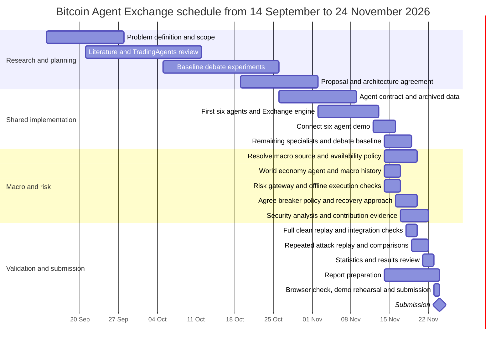

# Bitcoin Agent Exchange

A Bitcoin multi-agent research prototype that compares coin-weighted forecasts,
majority voting and a simple average, then tests how fake news changes forecasts
and simulated trading. Paper accounts use simulated USD and BTC; agent coins are
separate influence weights. No component places real exchange orders.

**Current scope:** all 13 specialist roles now have a daily forecast interface,
including new Chart, Long-term, Network and Miner adapters. Available inputs
control participation: an installed module does not imply a usable forecast.
A local dashboard collects live evidence, shows all abstentions, compares the
Exchange/vote/average, and records persistent, risk-constrained paper decisions.
Model components use Gemini only when explicitly requested and locally configured.
The bundled workflow replay remains synthetic and is not a research result.

This is the project's **single documentation guide**. All paths below are relative
to the repository root. Change an implementation at its canonical location;
the student-specific source directories have been removed from the root.
`compat/` contains only old package names and forwarding entry points. It keeps
teammates' older imports working after installation; it is not a second agent
system. Tests, scripts, fixtures and saved evidence live in the shared locations
listed below. Git history preserves earlier contributions.

## Contents

- [Setup](#setup)
- [Quick demonstrations](#quick-demonstrations)
- [Live dashboard and demo-day workflow](#live-dashboard-and-demo-day-workflow)
- [Folder and component map](#folder-and-component-map)
- [All 13 specialists](#all-13-specialists)
- [Agent interface and registration](#agent-interface-and-registration)
- [Forecast and paper-trading replay](#forecast-and-paper-trading-replay)
- [Data sources and timing](#data-sources-and-timing)
- [Model-backed specialist contract](#model-backed-specialist-contract)
- [Prediction-market evidence and live tools](#prediction-market-evidence-and-live-tools)
- [Risk and execution rules](#risk-and-execution-rules)
- [Tests and compatibility](#tests-and-compatibility)
- [Schedule and responsibilities](#schedule-and-responsibilities)
- [Saved examples and provenance](#saved-examples-and-provenance)
- [Remaining work](#remaining-work)
- [Attribution](#attribution)

## Setup

Use Python **3.11 or newer** for the unified project. From the repository root:
Use a fresh virtual environment when migrating an installation of the earlier
student-specific distribution to this shared package layout.

```bash
python -m venv .venv
# macOS/Linux
source .venv/bin/activate
# Windows PowerShell instead: .\.venv\Scripts\Activate.ps1
python -m pip install -e ".[test,macro]"
```

The core installs pandas; `test` adds pytest, and `macro` adds Yahoo download
support. For the model-backed specialists and read-only market-book tools:

```bash
python -m pip install -e ".[specialists,live,test,macro]"
```

The specialist extra installs Pydantic, Google GenAI, LangChain Core,
python-dotenv, Yahoo support and timezone data. The live extra adds Socket.IO.
Provider-specific extras `student2-google`, `student2-openai`,
`student2-anthropic` and `student2-aws` remain available for the optional model
clients. Installing a client does not authorize or trigger model calls.

Keep keys outside Git. CoinGecko live collection uses
`COINGECKO_DEMO_API_KEY`. News/Mood live model commands may use `GOOGLE_API_KEY`
or `GEMINI_API_KEY`; the model-client factory also supports provider-specific
configuration. Explicitly inject the chosen model client into replay adapters.
Use the configured environment rather than depending on an unrelated sibling
TradingAgents checkout. No credentials are needed for the offline demos or tests.

Old installation extra names remain accepted for compatibility. The redundant
legacy betting-client requirements file was removed; use the shared `[live]`
extra. All setup instructions live here.

## Quick demonstrations

```bash
# Inspect the single agent catalog without calling models or data providers
python -m agents

# Synthetic forecast -> risk -> independent clean/attacked paper accounts
python examples/paper_replay_demo.py

# Actual Borrowing/ETF/Crash/Contrarian code on labelled synthetic inputs
python examples/new_agents_demo.py

# Synthetic macro, paper execution, cap block, persistent halt and audited reset
python examples/student5_demo.py

# Independent stablecoin component demo (synthetic; not the whole ensemble)
python -m market_data.stablecoin demo
```

The paper and new-agent demos create timestamped `outputs/` directories. Their
input observations are synthetic and must not be presented as real-agent returns.
Those two replay examples do not supply the required durable risk configuration,
so their paper orders are blocked. The Student 5 demo uses explicit synthetic
breaker settings. The standalone stablecoin demo also uses synthetic settings and
routes its signal through the risk gateway. It requires an empty output directory;
use `--output` with a new path for another run.

For a reproducible offline Task 5 walkthrough, run `python examples/student5_demo.py`
and inspect the printed JSON and its saved `outputs/student5_demo/<run-id>/student5_demo.json`.
`risk_checks` shows an executed BUY, an oversized BUY blocked by the 25% cap,
and a forecast-swing halt. Compare the account after the block with the preceding
account: cash, BTC and fees remain unchanged. `restart_and_reset` uses a separate
flat account to show a halt still blocking after reopening the risk state, an
explicit reset, a subsequent BUY and the initialize/halt/reset audit events.
The example recreates a flat account; it does not restore a traded account. Both
the 0.30 forecast swing and 0.10 cumulative-loss limits are synthetic demo values,
not an agreed team policy. No provider or model calls are made.

## Live dashboard and demo-day workflow

**Live decision room:** generating a forecast queues all 13 specialists and
publishes real start/completion events, public evidence, probabilities and
measured durations. The current evaluator runs sequentially; Contrarian runs
last using completed peer forecasts. The UI polls faster while work is running,
shows queued/evaluating/forecasted/abstained/failed states, and retains the latest
run timeline after completion. Fast numerical agents can finish between refreshes;
no artificial processing delay or simulated thinking is added. Only returned
public evidence is shown, not private model reasoning. The activity trace is
included in each saved forecast JSON. Interrupted runs distinguish unreached
agents from returned abstentions. Forecast generation does not place a trade.

Immediately before a live forecast, the dashboard also collects 25 completed
Binance hourly candles and 61 completed minute candles. It saves the raw capture
under `outputs/dashboard/intraday/`. These are the minimum close counts needed
to calculate a 24h hourly return and a 60m minute return. The Chart agent combines
those returns with the completed-daily trend inside **one vote**. Missing
or stale intraday bars leave an explicit daily-only Chart result; the source status
shows the collection failure. The 50/35/15 blend is an uncalibrated research rule,
not evidence of improved accuracy. Historical CSV replays without archived
intraday candles still use the original daily-only Chart rule.


The interface uses a warm grey professional light theme and a market-terminal layout inspired by CoinMarketCap and
TradingView: real BTC daily candlesticks, source volume, EMA overlays, range
selection, a line/candle toggle, pointer crosshair, and an expandable chart.
The specialist table supports search, participation filters and evidence reports;
research results and paper decisions stay separate from the market chart.
Only retrieved values are plotted; missing price/volume statistics remain empty.
It uses local HTML/CSS/JavaScript with no third-party chart scripts or trackers.

**Gemini key:** set `GOOGLE_API_KEY` or `GEMINI_API_KEY` in the server's environment,
or put one of those names in a project-root `.env` file before starting the dashboard.
An existing server environment key takes precedence over `.env`; only Gemini keys
are loaded from that file. The dashboard never sends the key to the browser.
Alternatively, click **Connect Gemini** and paste the key into the masked field.
That session override is held only in the running server's memory, not files,
SQLite, browser storage, saved forecasts or Git.
The browser clears the input after submission/closing. Only a configured flag and
source are returned to the UI. The key is sent to Google when you explicitly run
a Gemini forecast/debate. Setting it makes no validation/model request by itself.
**Clear session key** removes the session override; an existing environment or
loaded `.env` key remains available. Restarting the server clears the session
override. Keep `.env` out of Git. See Google's [API key guidance](https://aistudio.google.com/docs/api-key).


```bash
pip install -e '.[test,macro,specialists,live]'
# Set GOOGLE_API_KEY or GEMINI_API_KEY in your environment or project-root .env.
# Optional: GEMINI_MODEL, COINGECKO_DEMO_API_KEY. Never commit keys.
python -m dashboard
```

Open <http://127.0.0.1:8765>. The server binds only to loopback. Choose **Refresh
market data**, **Generate 24h forecast**, then **Record paper decision**. A separate
**Compare Bull / Bear / Judge** button makes three Gemini calls over the same
audited reports; it does not add three extra specialist votes. No refresh makes
model calls or creates trades. Capture/configure inputs before the presentation;
provider failure appears as an abstention rather than fabricated data.
Refresh fetches Yahoo Bitcoin news. Forecast reuses that snapshot for up to two
minutes; after that it fetches news again and archives the forecast-time copy in
`outputs/dashboard/news/`. If the fresh fetch fails, the News specialist receives
no old articles and abstains. Repeated forecast clicks within two minutes reuse
the latest successful news fetch. Yahoo may rate-limit requests, and this reuse
window does not guarantee a provider quota.

The best demonstration pairs a fresh forecast (outcome due tomorrow) with a
completed historical replay (outcomes visible immediately). **Replay real BTC history** runs the latest 60 settled days from the collected
candles with the three price specialists and Contrarian; all missing non-price
sources abstain. The participation guard blocks new BUYs with only four active
agents. Its probabilities, paper accounts, baselines and uncertainty outputs are
saved under `outputs/dashboard/real_replays/`. The current dashboard replay does
not supply the required durable risk settings, so paper orders and baselines are
blocked. This is not the full 13-agent study.
The separate bundled replay is prominently **synthetic** and demonstrates the
pipeline only. A full performance study needs archived non-price evidence too.

The live target is strictly higher BTCUSDT at decision time +24h, with ties down.
Both reference and target use the last completed one-minute Binance close at or
before the exact timestamp. It is a recent observed reference, not a tick-perfect
execution guarantee. Only completed UTC daily candles feed daily price agents.
The latest 1,100 closes support Long-term's 791-day minimum warmup.

**Live learning (persistent settlement).** Every live forecast is recorded in
`outputs/dashboard/live_ledger.sqlite3` (`exchange/ledger.py`) with its reference
price and each active agent's probability. On the next **Refresh market data** or
**Generate 24h forecast** after a target time has passed, the dashboard fetches
the settlement price with `market_data.live.target_quote` (the same completed
one-minute close definition, at most two minutes before the target), pays out the
bets with the `exchange/engine.py` rules and saves each agent's new coins. The
next live forecast starts from those saved coins, so weights reflect only settled
outcomes, never pending ones. Forecasts settle oldest first and exactly once; ties
count as down; abstaining agents do not bet; an agent with no settled bet starts
at 100 coins. If the price cannot be fetched, nothing changes and the reason is
shown under `live_learning` in the forecast details. With a 20% cap, at least
six active agents are needed before learned coins can make weights unequal.

The synthetic replay uses the repository test fixtures and requires a checkout;
the installed dashboard HTML is also included as package data.

Live archives are in `outputs/dashboard/snapshots/`; full forecasts, evidence,
weights and model token/latency usage are in `outputs/dashboard/forecasts/`.
`outputs/dashboard/paper.sqlite3` persists account state and unique decision IDs.
Paper orders currently fail closed because the dashboard does not configure the
separate durable risk state, explicit breaker thresholds and BUY fraction. A
configured `PaperStore` uses separate account and risk-state transactions; a
mismatch after an interrupted update blocks further execution. The dashboard
requires a new fresh forecast after restart. A three-minute forecast/quote age
limit applies to paper decisions. BUY requires five active agents so the 20%
influence cap is feasible; unavailable/audit-failed agents are excluded. No
production breaker thresholds are assumed. A latched halt requires an explicit,
audited reset; the dashboard provides no reset button. SELL is also blocked when
the breaker is halted, and the gateway never forces a liquidation.

| Input | Live connection | Timing and remaining requirements |
| --- | --- | --- |
| BTC prices | Binance daily candles and completed one-minute reference | Crypto trades weekends; historical bars are features, current minute is the contract reference |
| Network/Miner | Coin Metrics community API | Daily publication delay; actual retrieval timestamp retained, incomplete current day excluded |
| Macro | Yahoo `DX-Y.NYB` and `^TNX` | Daily market proxies; forward fill holidays/weekends up to four calendar days, retain original session date; no claim of zero lag |
| Borrowing | Binance USD-M funding + OI | Recent completed history, receipt timestamps; older OI requires an archive |
| News | Existing Yahoo Bitcoin news fetch | Timestamped articles plus locally configured Gemini |
| Mood | Alternative.me Fear & Greed | Daily readings plus Gemini; not a real-time social stream |
| Stablecoin | CoinGecko | Local demo key; prospective same-source snapshots approximately 24h apart; no fabricated baseline |
| ETF | Reviewed `data/etf_flows.csv` import | Complete sourced flows and real availability timestamps; ETF prices are not fund flows |
| Betting odds | Bounded public Limitless discovery and Socket.IO book capture immediately before forecasting | Validates frame/timestamps and calls the evidence model; abstains if no usable book arrives |

DXY is an index, Yahoo is a provider, and FRED is another provider: they are not
three equivalent data series. Yahoo dollar/yield proxies suit this prototype's
frequent market context better than slowly released macro indicators. They still
have market hours, delays and revisions. Forward filling preserves the last known
observation; it does not create new weekend information. Newly retrieved vintages
are eligible for today's live forecast, not backdated historical forecasts.

`risk/auditor.py` checks result schema, evidence presence, supplied citation IDs
when available and timestamps. It is a deterministic validator, not independent
news verification. `risk.durable_gateway` enforces the configured circuit
breaker and the cost-aware 25% total BTC/equity ceiling; `risk.gateway` forwards
paper requests to it. For the historical runner, `--paper` requires explicit
breaker limits, initial forecast baseline and BUY fraction; without them all
orders are blocked. `--circuit-breaker` also enables the minimum-participation
guard. Every new runner execution also saves
`uncertainty.json`: missing forecasts are excluded, with circular seven-day block
bootstrap Brier intervals. Small samples remain unreliable.

**Debate as a fourth method.** `python -m experiments.run --debate ...` also runs
the Bull/Bear/Judge debate (`experiments/debate.py`) every replay day over the same
agent reports, and again on attack days. It costs 3 Gemini calls per day plus 3 per
attack day. Results get a `debate` column; `debate_log.json` keeps every argument
and `model_usage.json` the calls and tokens. A failed or invalid debate is left
missing, never filled in.

**Final results table.** After a run, combine everything into one table:

```bash
python -m experiments.report experiments/results \
    --baselines outputs/baselines_capped --price-in 0.25 --price-out 1.50 \
    --live-ledger outputs/dashboard/live_ledger.sqlite3 \
    --live-attacks outputs/live_attacks/all_shifts.csv
```

It writes `final_results.csv` and `final_results.md` with one row per method:
Brier score and 95% interval, direction accuracy, attack shift, paper returns (if
`--paper` was used), baseline returns and model calls, tokens and US$ per decision.
`--price-in/--price-out` are US$ per million tokens for the model actually used;
without them costs stay in tokens.

**Team-level fake-news test on live forecasts.** `experiments/news_robustness.py`
measures how much the News agent itself moves. `experiments/live_attack.py` answers
the research question at team level: it takes a saved dashboard forecast, re-asks
the News agent on that forecast's archived news snapshot, once clean and once with
a fake article (paired, order alternating), keeps every other agent's saved
forecast, recomputes Contrarian, and reports how far the Exchange (with the coins
it actually had), vote, average and optionally debate moved:

```bash
python -m experiments.live_attack --latest --attack all --repeats 2
```

Each pair costs 2 Gemini calls (`--debate` adds 6). Results go to
`outputs/live_attacks/<forecast>-<run>/` and are appended to
`outputs/live_attacks/all_shifts.csv`; pass that file to `experiments.report`
with `--live-attacks` to add a live attack column to the final table. A forecast
whose News agent abstains on either arm is recorded as not comparable. Daily
routine until the report: open the dashboard, **Refresh market data** (settles due
forecasts), **Generate 24h forecast**, then run the command above.

Cost-matched trading baselines have their own command:

```bash
python -m experiments.evaluation --prices data/btc_prices.csv --start 2026-09-01 --end 2026-10-31 --output outputs/baselines_capped
```

Supply at least 50 warmup daily closes and the day after the final forecast.
Signals use D close and execute at D+1 open with the same 0.10% fee and 5 bps
slippage. Without explicit risk configuration and an eligible forecast, the
baseline command records blocked paper orders. The current paper gateway does
not support uncapped execution or forced liquidation after price drift. A
synthetic baseline can supply explicitly labelled guard inputs through the Python
API; those inputs are not model forecasts. These utilities do not supply a
completed real-data study or repeated model attack experiment.

## Folder and component map

New live-demo components: `dashboard/__main__.py` serves the local UI;
`dashboard/index.html`, `dashboard/styles.css` and `dashboard/app.js` contain its interface;
`dashboard/credentials.py` isolates the memory-only session key;
`dashboard/activity.py` records thread-safe forecast execution events; `dashboard/service.py` connects
forecasting, audits and the persistent paper account. `market_data/live.py`
collects live vintages, using certificate-verified transport in
`market_data/http.py`. `model_clients/demo_gemini.py` bridges the existing Gemini
specialists; `experiments/debate.py` implements the separate debate baseline.
`experiments/evaluation.py` supplies trading baselines and bootstrap statistics.
`risk/auditor.py` and `risk/circuit_breaker.py` contain the added validators.


```text
dashboard/        Web interface and observable forecast execution
agents/           One roster and the real specialist implementations
market_data/      Provider collectors, input validation and packaged fixtures
exchange/         Agent coins, weights and ensemble methods
risk/             Evidence checks, circuit breaker and 25% exposure cap
execution/        Paper account and execution accounting
experiments/      Replay, debate and evaluation
features/         Shared calculations
model_clients/    Provider clients
verification/     Collection scripts and installation checks
examples/         Runnable demos and reference_runs/ archived evidence
tests/            All shared tests and test fixtures
compat/           Old import names that forward to shared implementations
```

| Canonical location | Responsibility | Important files |
| --- | --- | --- |
| `agents/` | Agent interface, roster, adapters and daily forecasts | `registry.py`, `adapters.py`, `schemas.py`, `template.py` |
| `agents/specialists/` | Model-backed implementations and the standalone stablecoin signal | `news_specialist.py`, `mood_specialist.py`, `betting_odds_specialist.py`, `market_evidence_specialist.py`, `stablecoin_signal.py` |
| `market_data/` | Macro, borrowing, ETF input preparation and Yahoo helpers | `macro.py`, `borrowing.py`, `etf.py`, `yahoo.py` |
| `market_data/bitcoin/` | Student 1 Binance Spot candles, archived daily history and download CLI | `binance.py`, `history.py`, `__main__.py` |
| `features/` | Shared technical-indicator calculations | `technical.py` |
| `market_data/stablecoin/` | CoinGecko snapshots, peg math, historical export and CLI | `data.py`, `peg.py`, `history.py`, `__main__.py` |
| `market_data/prediction_markets/` | Limitless book collection/discovery, Binance context and contract checks | `limitless_live.py`, `limitless_targeted_discovery.py`, `market_price_context.py`, `binance_raw_context.py`, `threshold_market_evidence.py` |
| `model_clients/` | Shared model-provider clients and configuration | `factory.py`, `api_key_env.py`, provider modules |
| `exchange/` | Agent coins, forecast weights and comparisons | `engine.py`, `vote.py`, `average.py` |
| `risk/` | Mandatory 25% BTC exposure approval | `gateway.py` |
| `execution/` | Paper-account accounting and optional execution-quality gate | `paper_trading.py`, `quality.py` |
| `experiments/` | Historical forecast/attack runner and portfolio replay | `run.py`, `paper.py` |
| `examples/` | Reproducible runnable demonstrations | The three demo scripts above |
| `tests/` | Offline tests and clearly labelled fixtures | `fake_agents/` are test agents, not research specialists |
| `data/` | User-supplied point-in-time CSVs and downloaded local data | See the data contracts below |
| `outputs/` | Generated results, raw snapshots and demonstrations | Ignored by Git |
| `examples/reference_runs/` | Previously saved historical evidence | Preserved unchanged; not current live outputs |
| `verification/` | Shared PowerShell transports and installation checks | `verify_installed.py`, `verify_fresh_environment.ps1`, `run_market_price_demo.py` |
| `market_data/stablecoin/fixtures/` | Stablecoin demo input | Synthetic packaged fixture |
| `market_data/prediction_markets/fixtures/` | Saved market response for verification | Historical example; not a current live quote |
| `compat/` | Legacy import aliases only | `student2`, `student4`, `crypto_trading`, `macro`, `tradingagents`; do not implement agents here |
| `licenses/`, `LICENSE` | Third-party and project licensing | Preserve when moving or reusing code |

The old `world_econompy.py` spelling is an import alias for
`agents/world_economy.py`; it is not registered as another agent. The standalone
stablecoin action signal and its daily probability adapter represent **one**
stablecoin specialist, not two votes. Evidence enrichment tools are not extra
voting agents either.

## All 13 specialists

| # | Specialist | Canonical implementation | Readiness and input |
| --- | --- | --- | --- |
| 1 | Chart | `agents/chart.py` | 70 completed BTC daily closes; live forecasts additionally use completed hourly/minute candles when captured. Student 1 descriptive reports remain in `agents/specialists/` |
| 2 | Borrowing | `agents/borrowing.py` | Funding/OI CSV, six consecutive completed days |
| 3 | Network | `agents/network.py` | Eight consecutive published active-address/transaction days; Coin Metrics collector |
| 4 | Miner | `agents/miner.py` | Eight published hash-rate/fee days; measures health proxies, not actual miner sales |
| 5 | Stablecoin | `agents/stablecoin.py` | Archived near-day-end snapshots; price-adjusted supply and peg heuristic |
| 6 | ETF | `agents/etf.py` | Complete timestamped aggregate US spot-BTC ETF net flows |
| 7 | News | `agents/specialists/news_specialist.py` via `agents/adapters.py` | Explicit model client, timestamped articles and agreed settlement contract |
| 8 | Mood | `agents/specialists/mood_specialist.py` via `agents/adapters.py` | Explicit model client and historical sentiment snapshots |
| 9 | World economy | `agents/world_economy.py` | Yahoo DXY and Treasury-yield macro CSV |
| 10 | Betting odds | `agents/specialists/betting_odds_specialist.py` and evidence model via `agents/adapters.py` | Validated market book, explicit model and matching team event |
| 11 | Crash | `agents/crash.py` | 91 consecutive completed daily BTC closes |
| 12 | Long-term | `agents/long_term.py` | 791 completed daily closes minimum; walk-forward residual-neighbour frequency. Original descriptive fit retained |
| 13 | Contrarian | `agents/contrarian.py` | Second stage; at least three valid same-day independent forecasts |

The implemented rule-based agents produce uncalibrated research heuristics,
not trained or statistically validated next-day probabilities. Borrowing uses a
funding/OI crowding rule (0.38–0.62); ETF uses the mean of three flow reports
(0.40–0.60); Crash uses historical tail loss and drawdown (0.35–0.50); World
economy uses dollar/yield pressure (0.40–0.60). Their coefficients and thresholds
need held-out evaluation. The Crash implementation does not claim to reproduce
a specific paper's estimator.

## Agent interface and registration

New daily agents implement:

```python
AGENT_NAME = "unique_name"

def forecast(day, data):
    return {
        "agent": AGENT_NAME,
        "day": day,
        "p_up": 0.5,
        "evidence": ["explain input dates and calculation"],
        "data_missing": False,
    }
```

Copy `agents/template.py`; keep implementation under `agents/` and declare one
unique name. The runner scans top-level forecast modules, skips helpers,
compatibility aliases and the template, and **rejects duplicate names**. The
catalog in `agents/registry.py` records all 13 planned roles. Do not register a
specialist twice under different aliases or copy its implementation into another
student folder.

The runner gives agents only CSV rows dated through `day`. Agents with separate
release/receipt timestamps must additionally check availability at the actual
forecast cutoff. Missing/invalid answers abstain and are excluded from scoring,
weights and settlement. A genuine 0.5 is a valid neutral forecast. The runner
clips valid probabilities to 0.05–0.95. If too few active agents can satisfy the
20% direct influence cap, the current engine uses equal weights and records
`cap_feasible=False` rather than claiming the cap held.

Contrarian has `FORECAST_STAGE = "ensemble"`. It reads a frozen numeric
`peer_forecasts` snapshot of same-day first-stage results; it never reads itself,
other second-stage outputs, arguments or future outcomes. At least 80% must
agree directionally and their mean must be at least 0.10 away from 0.5 before it
opposes consensus. On News attacks, Contrarian is recomputed from attacked peer
values without rerunning unaffected model calls. With dependent agents, a direct
weight cap is not a bound on an attack's total causal effect.

News/Mood/Betting remain explicitly registered adapters because they need models
and a precise event definition. Import the common adapter from
`agents.adapters`; its legacy `Student2Adapter` name is still supported. Existing
`student2_*` snapshot keys and `--student2-inputs` remain the data protocol, not
separate agent implementations. See their contract below.

## Forecast and paper-trading replay

```bash
python experiments/run.py --start 2026-09-01 --end 2026-10-31 \
  --data-dir data --agents-dir agents --paper --out outputs/team_replay_01
```

Supply real recorded prices and required specialist inputs. The runner needs a
price after the final forecast day. Use a new output directory; the paper stage
refuses to overwrite existing accounts. The default policy is BUY for
`p_up >= 0.55`, SELL for `p_up <= 0.45`, otherwise HOLD. Change
`--buy-threshold` and `--sell-threshold` equally for all methods if needed. These
are demonstration thresholds, not optimized trading rules.

Paper execution also requires explicit breaker limits, an initial forecast
baseline and a BUY cash fraction. Without all four settings, orders fail closed;
no production values have been agreed. For a synthetic offline replay only,
pass `--synthetic --risk-max-forecast-swing 0.9 --risk-max-cumulative-loss 0.9
--risk-previous-forecast 0.5 --paper-buy-fraction 0.24` along with the command
above and synthetic inputs. The settings are demonstration choices. Every
replay account has its own durable risk state; an existing output is never reset.

Forecast D uses completed inputs through D; execution is at the following UTC
day's **open**, with adverse slippage and fees. This abstracts computation/order
latency; it does not guarantee an achievable real fill. With close-only data,
explicitly use `--execution next_close`: execution is delayed until D+1's close,
never the D close already used by the forecast. Missing daily price rows are
rejected rather than silently filled.

Each method/scenario owns an independent $10,000 account, persistent throughout
that replay. Defaults are 0.10% fees, 0.05% slippage and a 25% BTC exposure cap.
The runner's original forecast, coin, attack and score CSVs remain available.

| Output | Meaning |
| --- | --- |
| `forecasts.csv` | Forecasts, participation and abstention reasons |
| `coins.csv` | Influence weights, balances and cap feasibility |
| `attack.csv`, `summary.csv` | Comparable forecast shifts and forecast scores |
| `paper/clean/{exchange,vote,average}/trades.csv` | Simulated fills, fees, balances and realized profit |
| The same folders' `risk_decisions.csv` | Requested/approved action, forecast availability, reason, execution time and exposure |
| The same folders' `equity.csv`, `portfolio.json` | Daily marks and final account |
| `paper/attacked/...` | Separate attacked portfolios when attack rows exist |
| `paper/summary.csv`, `paper/run.json` | Portfolio comparison and run assumptions/provenance |

Attacked portfolios use comparable attacked forecasts on attack dates and clean
forecasts otherwise. Noncomparable/missing attacked results request HOLD and are
marked missing. This uses the clean Exchange coin history: it is a local
intervention study, not a separately settled poisoned economy. Plain fake-headline
strings are not valid timestamped article injections for the model-backed News
adapter. Noncomparable rows are not evidence of robustness.

A replay starts fresh accounts. Exports do not automatically resume a live account
or schedule a background service. The dashboard displays forecasts and paper
outcomes, subject to its explicit risk-configuration limitation described above.

## Data sources and timing

Every CSV uses a `date` column that the runner indexes. Distinguish observation
time, publication/receipt time and the forecast cutoff. Preserve provenance and
revisions; downloading a historical value today does not prove it was known on an
old forecast date. Demo data must stay explicitly labelled synthetic.

### BTC prices

`data/btc_prices.csv`: `date,open,close`, consecutive daily UTC candles. Close-only
input is allowed only with explicit delayed next-close paper execution. Use the
same provider and endpoint convention declared in model-backed contracts.

Student 1's paginated collector saves the additional OHLC/volume/timestamp fields
needed by the Chart and Long-term report loaders, while remaining compatible
with the ensemble runner:

```bash
python -m market_data.bitcoin --start 2020-01-01 --end 2026-10-31 --output data/btc_prices.csv
python -m agents.chart_report --interval 1d --history data/btc_prices.csv
python -m agents.long_term_report --history data/btc_prices.csv --as-of 2026-10-31
```

The collector uses public Binance BTCUSDT Spot data, rejects unfinished days and
gaps, and can round-trip the full daily CSV. The Chart report describes EMA,
MACD, RSI, ATR, volume and taker-buy context; without `--history` its CLI retrieves
recent completed candles (15m by default). Its model prompt/response validator
does not connect an LLM provider automatically. Long-term fits log(price) against
log(time since genesis), using only data through `--as-of`, with at least 365
observations spanning two years. Its one-year line is an exploratory extrapolation,
not a next-day prediction. BTCUSDT values are not a BTC/USD index; treating them
as USD paper-account quotes is an explicit proxy assumption.

The separate student installer is consolidated into the root `pyproject.toml`.
Install the shared project from the repository root. Legacy `crypto_trading.*`
imports and module commands still forward to the canonical implementations.

### World economy and macro

```bash
python -m market_data.macro --start 2026-08-01 --end 2026-11-13
```

Yahoo `DX-Y.NYB` supplies DXY; `^TNX` supplies the 10-year Treasury yield in quoted
percent units. Treasury yield is a market proxy, not the Fed policy rate. The
collector writes `data/macro.csv` and raw snapshots in `data/macro_raw/`.

Fields include `dxy`, `treasury_10y`, each series' `*_observed_on`,
`*_available_at`, `*_forward_filled`, plus `source`, `availability_basis`,
`retrieval_completed_at` and `publication_basis`.
Completed session D is **assumed** available at D+1 00:00 UTC. This is not a Yahoo
publication SLA or a verified vintage archive. Today's incomplete UTC date is
rejected. Forward fill carries the last known value through weekends/holidays
for at most four calendar days, retaining the actual source date; there is no
backfill from future values. The agent compares five distinct source sessions,
not five duplicated weekend rows. Include enough warmup history in the CSV.

The heuristic is `p_up = 0.5 - 0.1*tanh(0.6*dollar_change_percent/1.0 +
0.4*yield_change_percentage_points/0.25)`. Stronger dollar/rising yields are
assumed headwinds. FRED/ALFRED vintages would support a different publication-time
study; the Fed's H.10 dollar series releases prior-week observations on Mondays,
so its daily labels do not imply zero publication lag.

### Borrowing

```bash
python -m market_data.borrowing --start 2026-11-07 --end 2026-11-14
```

`data/borrowing.csv` needs `date,funding_rate,open_interest_usd,available_at,
complete,source`. Funding is the daily mean **per-8-hour decimal** rate:
0.0001 means 0.01% per settlement. OI is dollar notional, not BTC quantity; Binance
USDT values are labelled USD proxies. Six consecutive completed days are needed,
with the latest at most one calendar day old. Do not fill crypto-derivative
weekend outages as if observations were recorded.

The read-only Binance collector expects ordinary 00:00/08:00/16:00 UTC funding
and a period-end OI observation within the final hour. It saves raw responses,
marks incomplete days, and assigns actual receipt time as availability. The API
has only about one month of OI history, so requests are limited to the last 25
days. September/early-October replay needs a preexisting trusted archive. There
are no keys, orders, automatic retries or TLS bypasses. A local smoke attempt
failed certificate verification; a live feed is not claimed as verified.

### ETF flows

```bash
python -m market_data.etf path/to/reviewed_flows.csv --units usd_millions
```

`data/etf_flows.csv` needs `date,net_flow_usd,available_at,complete,source`.
Use complete **aggregate US spot-BTC ETF net creations/redemptions**, not share
returns, trading volume or unadjusted AUM changes. The input amount column keeps
its name even when `--units usd_millions` converts source amounts into dollars;
use `--units usd` for dollar input. The importer validates types, timezones,
source names and duplicate vintages. Preliminary/blank flows are not zeros.

Farside's public totals are in US$ millions, but its evolving table does not
establish historical first-publication timestamps. Import reviewed data with a
preserved source/availability record rather than inventing a release time. The
agent uses three reports within seven calendar days and carries published
information through weekends/holidays for at most four days. It does not invent
weekend flow entries. Later revisions may share `date` but need different
`available_at`; only a vintage already available at the cutoff can be used.

### Stablecoins

```bash
python -m market_data.stablecoin collect --output outputs/baseline.json
python -m market_data.stablecoin collect --previous outputs/baseline.json --output outputs/current.json
python -m market_data.stablecoin export-history outputs/nov06.json outputs/nov07.json --output data/stablecoin.csv
```

CoinGecko collects USDT, USDC and DAI prices, market cap, volume and provider times.
The daily CSV contains `date,source,observed_at,available_at` and
`{usdt,usdc,dai}_{price_usd,market_cap_usd,updated_at}`. The exporter uses actual
collection time, rejects duplicate daily snapshots, and does not backdate newly
downloaded historical values. Choose a snapshot from the last 15 minutes of each
UTC day; provider quotes must be fresh. Comparable observations are approximately
24 hours apart from the same source, with advancing provider timestamps.

The daily adapter sums market cap/price as a price-adjusted supply proxy. It is
not measured mint/burn or exchange inflow. Stable pegs support a smooth
uncalibrated 0.40–0.60 forecast; a 0.5% peg warning suppresses the supply signal,
and 2% stress gives 0.40. A single provider does not confirm a multi-source depeg.
The standalone BUY/SELL/HOLD rules remain separately usable for component testing
but are not a second ensemble vote.

## Model-backed specialist contract

The adapter lives at `agents/adapters.py`; News, Mood and Betting implementations
live in `agents/specialists/`, with shared validated results in `agents/schemas.py`.
Model clients are injected explicitly. Nothing in the runner creates a paid
client automatically.

```python
from agents.adapters import SpecialistAdapter

adapters = {
    adapter.AGENT_NAME: adapter
    for adapter in (
        SpecialistAdapter("news", model_client=news_model),
        SpecialistAdapter("mood", model_client=mood_model),
        SpecialistAdapter("betting_odds", model_client=market_model),
    )
}
# Pass adapters, saved day snapshots and settlement metadata into run(...).
```

For each day, the snapshot's `student2_forecast` explicitly declares:

- `prediction_time` and `target_time`: aware timestamps exactly 24 hours apart,
  with prediction UTC date matching the runner's day;
- `price_source` and `reference_price_definition`: the actual provider and
  endpoint convention for both prices;
- `tie_definition: "down"`: an exact tie is not Up.

Also provide the matching `student2_news_articles` / `student2_news_observed_at`,
`student2_mood_readings` / `student2_mood_observed_at`, or
`student2_market_observation` / `student2_markets_observed_at`. Observation times
must be aware and no later than prediction; evidence must not be newer than its
snapshot. Publication timestamps alone do not prove when contents were obtained
or revised. News checks dated accepted evidence and model citations; undated
articles can be excluded while preserving other valid articles. Betting may
add explicit `student2_price_context` for Binance BTC/USDT spot.

`run(...)` accepts `student2_adapters`, `student2_inputs` (date-to-snapshot mapping)
and `settlement_contract`. The latter declares `price_source`,
`reference_price_definition`, `tie_definition: "down"`, and `close_times` mapping
CSV dates to actual aware close timestamps. The runner verifies both endpoints,
24-hour duration, source and tie rule against the CSV metadata. These declarations
must be true of the data, not labels invented to make mismatched prices fit.

`--student2-inputs bundle.json` loads `days` and `settlement` and registers the
three offline adapters. **Without injected clients, this CLI alone does not
produce model-backed forecasts.** Only `student2_*` snapshot keys are overlaid;
they cannot replace the price tables. Insufficient inputs abstain with null
probability. All-abstain days have blank scores, no active weights and unchanged
agent coins. A real 0.5 remains a forecast. Unstructured `fake_headline` text is
rejected until supplied as properly timestamped article evidence.

## Prediction-market evidence and live tools

Canonical data tools live in `market_data/prediction_markets/`. A market's YES
payout midpoint is **not automatically** the probability of the team's different
next-24-hour event. Split payouts imply an idealized expected payout involving
tie probability, and real spreads add further differences. Do not invent an
unknown tie probability or convert intervals mechanically.

```bash
python -m market_data.prediction_markets.limitless_live
# Select a known supported daily market if needed:
python -m market_data.prediction_markets.limitless_live --slug EXACT_SLUG
```

The live reader requires a subsequent increasing-version streamed full-book
snapshot after the initial snapshot, a recent provider event timestamp, valid
outcome mapping and nonempty two-sided depth. Midpoint, depth and timestamp must
come from the same accepted frame. Sequence/time reversal fails. It saves raw
market, book, quote summary and statuses; it does not create a wallet or order.
REST listing receipt time is not quote freshness. Missing/unsupported markets,
quiet streams and provider errors are legitimate unsuccessful outcomes.

Discovery is bounded: the full reader allows 30 seconds/up to 20 listing pages
with 10-second per-request limits; one stream attempt has a configured 20-second
wait plus underlying connection timeouts. There are no automatic retries. The
optional price-context demo uses a separate bounded three-page targeted search
and detail validation, not an exhaustive discovery claim.

Preserved Windows helpers:

```powershell
powershell -NoProfile -File .\verification\collect_limitless_markets.ps1 -OutputPath .\outputs\limitless-listing.json
python -m market_data.prediction_markets.limitless_live --listing-file outputs/limitless-listing.json
python -m verification.run_market_price_demo
```

Choose new listing filenames; provenance is caller-attested, not independently
authenticated. The targeted discovery's packaged PowerShell helper remains under
`verification/get_limitless_public.ps1` so installed and existing
Windows workflows resolve the same file. Optional strict contract flags must be
supplied together; they do not alter the market's actual rules.

A validated book can become evidence for an explicitly supplied model estimate
through the adapter; the quote itself stays separate from the team's probability.
Unavailable/mismatched evidence or model access abstains. Previous saved Limitless
examples are not proof of successful current live book capture or calibrated
forecasting. Offline transport tests use mocks, not live execution.

## Risk and execution rules

`execution/paper_trading.py` owns account math. Public paper execution requires
an explicitly initialized `risk.durable_gateway.RiskGateway`; without one it
fails closed. `risk.gateway.execute_guarded` forwards the actual requested
order and forecast to that gateway once. Configure explicit `RiskPolicy`
forecast-swing and cumulative-loss limits, an aware timestamp, a previous
forecast and a BUY fraction; the project has no agreed production values for
those settings. Each state file is initialized explicitly, is bound to an
account and stores halts across normal restarts. A reset requires a caller-
attested actor, reason, timestamp and baseline and is audit logged.
The breaker halts at or above either configured absolute forecast swing or loss
from initial equity at the supplied quote. A halt blocks SELL as well as BUY.
Reset does not waive the limits: if the loss still breaches its threshold, the
next check halts again. The reset actor is not authenticated by this prototype.

The invariant at each checked execution quote is BTC market value <= 25% of
post-cost portfolio equity. BUY sizing includes existing holdings, fees and
slippage. A request exceeding the cap is blocked rather than resized. A HOLD
or BUY does not cause an unsolicited SELL when price drift makes BTC overweight;
an explicit SELL may reduce the position unless the breaker has halted. Missing
forecasts remain unavailable and never authorize a trade. The 25% exposure cap
is separate from the Exchange's 20% agent influence cap.

The dashboard's `PaperStore` requires an explicit policy, an already initialized
risk-state path and a BUY fraction. Its default configuration blocks orders and
reports the missing settings. Dashboard account and risk state use separate
SQLite transactions: if a process stops between commits, the account mismatch
blocks subsequent orders and requires inspection. Account restoration and
identity authentication are not provided; a storage failure also prevents a
durable halt guarantee. These limitations preclude claiming production readiness.

The optional `execution/quality.py` wrapper checks timestamped bid/ask and
executable ask depth before BUY. Missing or stale liquidity defers BUY without
mutating balances, while the durable gateway still checks breaker triggers.
SELL and HOLD preserve the requested action and pass through the durable gateway.
OHLC replay does not invent historical liquidity.

Accounting uses Decimal, whole-satoshi quantities, buy fees in cost basis and
sell fees deducted from proceeds. Equity marks BTC at the supplied price without
hypothetical liquidation costs. There is no leverage, shorting or exchange order;
cash is simulated fiat USD and is not revalued with stablecoin pegs.

## Tests and compatibility

```bash
# Full offline suite after installing specialists, live and test extras
python -m pytest -q

# Core pipeline plus the newly integrated stablecoin tests
python -m pytest tests/test_new_specialists.py tests/test_paper_pipeline.py \
  tests/test_runner_abstentions.py tests/test_student5_gateway.py \
  tests/test_student5_macro.py tests/test_engine.py tests/test_student4.py \
  tests/test_student4_integration.py tests/test_project_layout.py -q
```

Compatibility files in `compat/` forward to the same canonical module object, including
private helpers, classes and monkeypatch targets. They contain no second agent
algorithm. After installing the project, existing imports and `python -m student4 ...`,
`python -m macro.collect ...`, and legacy Student 2 module CLIs keep working.
For source-only tests, pytest adds `compat/` to its import path. Installed wheels
expose the old package names directly, without exposing `compat` as a new API.
The redundant `student1/src/crypto_trading/` copy was removed; its unique tests
are now `tests/test_market_reports.py` and `tests/test_price_history_reports.py`.
For new code use the canonical paths in the map above. Keep archived JSON evidence
and third-party license files; moving documentation is not permission to rewrite
historical results.

The shared fresh-wheel Windows verifier is
`verification/verify_fresh_environment.ps1`. It checks installed package
imports/helpers and runs checkout-based offline tests. Ordinary tests do not
validate live API credentials or forecast accuracy.

Layout cleanup on 16 November 2026 moves all legacy names under `compat/`,
collects tests in `tests/`, and makes runtime fixtures and verification scripts
independent of student-specific directories. Saved evidence is preserved under
`examples/reference_runs/`. The price/report tests were moved, not discarded.

Verification of this layout: **440 tests and 127 subtests passed**; six
PowerShell-only tests were skipped because PowerShell is unavailable here.
A fresh wheel was built and installed, and shared modules, legacy aliases,
packaged fixtures and helper scripts were verified outside the checkout.
Both the canonical and legacy stablecoin demo commands completed with the
same labelled synthetic inputs and results.

Verification after the live-dashboard and 13-interface integration on 15 November 2026:
**439 tests and 127 subtests passed**, including the shared price/report suite;
six PowerShell-only tests were skipped because PowerShell is unavailable on this
machine. Session-key privacy, local HTTP authorization, input clearing/form safeguards,
Gemini key injection and bounded chart payloads are covered by the test suite.
The redesigned interface was checked with real candles, price/volume overlays,
chart ranges, agent filters/search and evidence dialogs.

The live integration produced a forecast from eight agents using retrieved Binance,
Coin Metrics and Yahoo inputs; five roles abstained with unmet input/model requirements.
A 60-day real BTC price-only replay and the guarded paper-decision UI were verified.
The updated wheel built from a fresh temporary source staging directory, and new
modules, the 13-role catalog and packaged dashboard HTML imported successfully
outside the checkout. No Gemini inference was verified without a local key.

The World Economy agent uses `market_data.macro_point_in_time` for both the
latest observation and its six-session lookback. It rejects future, conflicting
and stale records and reports their original observation date and data age.
The historical Yahoo path explicitly opts into assumed next-midnight availability;
its publication timestamp remains unknown. The live path uses the actual
completion time of both downloads, not a provider publication timestamp. The
selector's publication times are caller-attested and never independently
verified. Retrospective Yahoo data with unknown vintages cannot establish what
was actually known at a historical prediction time.

[Student 2 evidence notes](docs/student2-evidence-notes.txt) preserve the useful
caveats from the six guides consolidated by main. Market 463042 has no recorded
retrieval timestamp and is not a fresh quote; a book event timestamp does not
prove resting-order age or execution. A model estimate is separate from the
market midpoint, and numerical equality alone is not invalid. Retrospective
examples do not establish prospective accuracy or calibration.

The earlier organization wheel built successfully, and isolated installed imports and packaged
helpers were verified outside the checkout. Both the stablecoin component demo
and the new-specialist paper replay completed using labelled synthetic data.

## Schedule and responsibilities

Task 5 verification on 16 November 2026: **550 tests and 132 subtests passed**
with three dependency deprecation warnings on Windows, using a fresh workspace-local
pytest temporary directory. The mocked PowerShell collector's three tests passed;
no timeout increase or provider calls were needed. The default system pytest temp
directory was inaccessible in this environment.

Task 5 reconciliation status (16 November): the offline checks exercise the
caller-attested macro selector, paper exposure cap, breaker restart and audited
reset, and dashboard decision data. Browser presentation still needs the manual
check below. Historical macro provider/vintage policy, team breaker thresholds,
account recovery and cross-database crash reconciliation remain open. Synthetic
example values are not approved team settings. Student 2 live market forecasting
remains subject to the source, timestamp and contract limitations above.

Manual dashboard check with controlled offline fixture data: confirm mixed
forecasts, abstention reasons and failures, including an all-abstain run; compare
an executed BUY, a cap-blocked BUY, a halted SELL and a HOLD with their supplied
status, reason, ledger and balances; reload and check the persisted decision.
Confirm the default configuration reports the breaker as unconfigured. An
executed order requires an explicitly configured paper policy and state; the
default dashboard deliberately blocks orders. Browser rendering has not been
verified in this workspace.

Planning window: **14 September–24 November 2026**, assuming submission on
24 November. The chart is an editable planning baseline, not evidence that tasks
were completed on those dates. Confirm actual dates and status with the team.




Edit the canonical implementation on your own branch, fetch recent work before
merging, and retain one registration per specialist. Update this README whenever
locations, commands or interfaces change. The earlier 30 November proposal must
be reconciled with the assumed 24 November submission deadline.

## Saved examples and provenance

Historical examples remain in `examples/reference_runs/`: the Mood run from
9 November, News probe from 11 November, and paired fake-headline example under
`news_specialist_fake_headline_20261110/`. The latter records an older
7–8 November prediction window and a synthetic injected headline. These are saved
references, not fresh forecasts or proof of general robustness. Fixture manifests
retain synthetic provenance without leaking experimental labels into the model
prompt.

The initial proposal reports earlier debate experiments; those reports do not
substitute for a complete current replay. Synthetic demo outcomes, one paired
attack and a successful data download must not be described as final research
results. Full-day evidence persistence beyond the runner's probability CSVs needs
care; the sample new-agent demo saves its complete agent evidence explicitly.

## Timestamped fake-news comparisons and actual Gemini responses

The dashboard loads Gemini keys from a local `.env` at startup (existing environment values take
precedence). Add `GEMINI_API_KEY=...` there, or use the dashboard's masked session
key field. `.env` and `outputs/` are ignored by Git. Restart after editing `.env`.
Never add the key to a tracked configuration file.

Betting odds now follows public bounded discovery → selected market detail
validation → timestamped two-sided Socket.IO book → explicit model estimate →
schema/citation validation → audited specialist result. Collection runs immediately
before the forecast reference quote and cutoff are chosen. A failed refresh clears
the previous book. The stream and model estimate stay separate from the market's
YES payout midpoint; neither REST prices nor a synthetic book replace a failed
live feed. Full-book updates and increasing versions are required; unsupported
rules, partial frames, stale quotes, disconnects and quiet streams cause abstention.
The portable discovery search checks at most five pages and is not exhaustive.
Raw public capture and failure status are saved in `outputs/dashboard/books/`.
Native certificate trust is used with verification enabled. The default public
transport implements the documented Engine.IO v4/Socket.IO text handshake,
subscription and heartbeat over WebSocket in `public_stream.py`; an injected
Socket.IO client factory remains supported for older callers. The first book
snapshot is discarded and a subsequent increasing version is required. Provider
clocks may lead local receipt by at most 500 milliseconds: that measured skew is
disclosed in the saved quote/model evidence and both original timestamps remain
unchanged. Larger future offsets and books older than 30 seconds are rejected.

Run the repeated two-specialist experiment from the project root:

```bash
# Collect real Yahoo BTC articles and Alternative.me FNG once; no Gemini calls:
python -m experiments.news_robustness --prepare-only --attack all

# Two independent clean/attacked repeats: eight potentially paid Gemini calls.
# Uses GEMINI_MODEL, or pass --model with an available Gemini model name.
python -m experiments.news_robustness --live --repeats 2 --attack bearish_claim

# Three prepared scenarios, three repeats: 36 potentially paid calls.
python -m experiments.news_robustness --live --repeats 3 --attack all
```

Each run freezes the real input snapshot and 24-hour target. Prepared attacks
include unverified bearish/bullish claims and a prompt-injection article, with
explicit scenario publication timestamps no later than the prediction cutoff.
They are local fabricated articles, never published externally or labelled as
verified Yahoo stories. Ground truth is saved separately from model evidence.
The runner appends an article directly instead of using the older unsupported
`fake_headline` string. Mood consumes only FNG, so its input stays unchanged as a
negative control. Each repeat re-runs clean and attacked arms; their order alternates.

`outputs/news_robustness/<UTC timestamp>-<id>/` contains exact inputs, SHA-256
hashes, attack manifests, each prompt/raw Gemini response, parsed result, provider
response ID when available, token usage, timestamps and `summary.json`. Invalid
responses and abstentions remain incomplete pairs; they are never filled with
0.5 or counted as zero shifts. Shared parsing accepts SDK parsed models, JSON
text, text blocks and a single JSON fence, and rejects duplicate keys, truncated
JSON, nonfinite numbers and invalid probabilities. News spelling variants such
as `news_specialist` normalize to the registered identity.

On 18 November 2026, the complete live Betting Odds path also passed: native
public discovery and book capture produced a fresh validated observation, and
one actual Gemini structured response produced a validated 0.508 model estimate.
This is separate from the observed contract's payout midpoint and is uncalibrated.

On 18 November 2026, eight real `gemini-3.8-flash` responses passed validation in
two clean/attacked repeats. News changed from 0.38 to 0.36 and from 0.39 to 0.32
under the bearish-claim scenario (mean absolute shift 4.5 percentage points).
The unchanged-input Mood control also varied (mean absolute shift 2.5 percentage
points). These small runs verify the connection and parsing, and illustrate model
variation; they do not establish causal attack effects, robustness, forecast
accuracy, or full 13-agent performance. Results remain local in ignored outputs.

Final validation for this update: **599 tests and 127 subtests passed**, with six
PowerShell-only skips. A fresh wheel built successfully and installed imports,
legacy aliases and packaged resources were checked outside the checkout.

## Remaining work

- Verify sustained live Betting odds availability on the demo network. The
  dashboard now captures a fresh public book and validates Gemini JSON output;
  missing/invalid streams abstain rather than borrowing REST quote timestamps.
- Live learning is implemented (`exchange/ledger.py`), but it needs several days
  of real forecasts before any agent's coins differ meaningfully. Until then, use
  settled replay outcomes to demonstrate learning. With a 20% influence cap, at
  least six active agents are needed to demonstrate unequal capped weights.
- Validate the Bull/Bear/Judge debate with Gemini and evaluate held-out forecast
  outcomes. Actual News/Mood responses were verified on 18 November 2026;
  successful response parsing does not establish forecast accuracy.
- Supply reviewed timestamped ETF-flow reports, a valid fresh prediction-market
  book, and a CoinGecko key plus comparable snapshots approximately 24 hours apart.
- Archive point-in-time evidence prospectively. Downloaded historical prices and
  metrics cannot reconstruct historical article availability or revised vintages.
- Calibrate/evaluate the new heuristics on held-out data. A rolling intraday 24h
  target differs from the daily-close replay target and needs its own evaluation.
- Run the planned real-data period and repeated paired attacks, then report
  completed outcomes, position changes, uncertainty and measured model usage.
  The existing bare-headline replay cannot replace timestamped News experiments.
  Hidden-prompt, whale and memory-poisoning studies remain experimental work;
  no memory-poisoning result should be claimed without a memory subsystem.
- Finalize the report, individual contribution evidence and presentation.
  Recruiter remains optional for SDP 1.

## Attribution

Preserve the project `LICENSE` and `licenses/pharos-MIT.txt`. The stablecoin peg
helper adapts `relativeBps`/`deriveDepegSignal` from
[Pharos](https://github.com/TokenBrice/pharos-watch), revision
`8d554949ff7498e44d0f1a1e275d677fdbffd7b5`, with Decimal arithmetic. Pharos's broader
monitoring pipeline and confirmation logic were not imported. Curvemetrics was
reviewed but no code was imported. Provider APIs supply observations, not vendored
provider code.

Implementation references: [Yahoo delays](https://help.yahoo.com/kb/finance/article-exchanges-data-delays-sln2310.html),
[Federal Reserve H.10](https://www.federalreserve.gov/releases/h10/),
[FRED vintage periods](https://fred.stlouisfed.org/docs/api/fred/realtime_period.html),
[Binance market data](https://developers.binance.com/en/docs/catalog/core-trading-derivatives-trading-usd-s-m-futures/api/rest-api/market-data),
[Farside ETF totals](https://farside.co.uk/BTC/),
[Coin Metrics community API](https://github.com/coinmetrics/docs-website/blob/master/api.md),
[Gemini models](https://ai.google.dev/gemini-api/docs/models), and
[Limitless market-data documentation](https://docs.limitless.exchange/developers/websocket/market-data).
