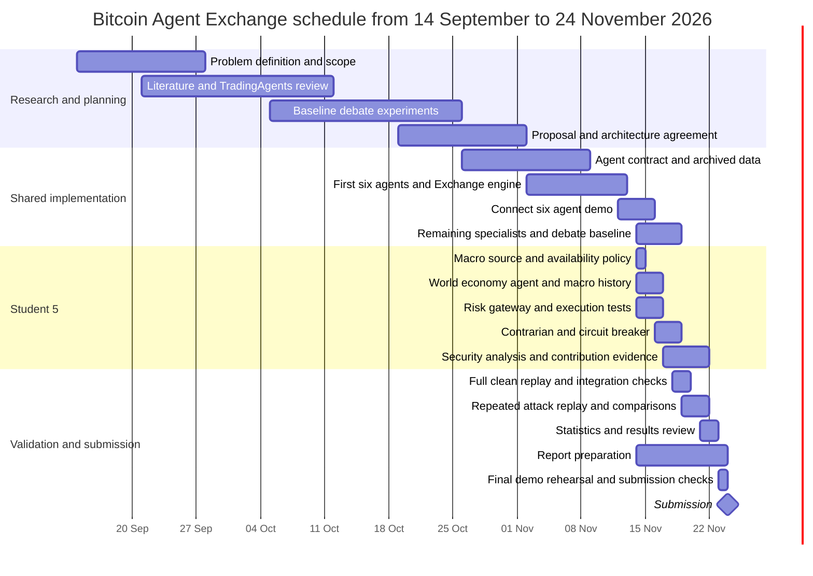

# SDP project schedule template

Planning window: **14 September to 24 November 2026**. Submission is assumed to
be 24 November as requested. This is an editable planning baseline, not a claim
that earlier tasks were completed on these dates. Replace dates, owners and
status after the team confirms actual progress. GitHub renders the chart below.

| Work package | Owner | Dependency | Status to update | Evidence to link |
| --- | --- | --- | --- | --- |
| Chart and Long-term | Student 1 | Historical BTC prices and forecast contract | Confirm actual status | Commit, tests, sample evidence |
| News, Mood and attack fixtures | Student 2 | Dated articles, sentiment history | Confirm actual status | Commit, clean and attacked samples |
| Exchange, vote, average and runner | Student 3 | Common probability output | Confirm integration | Commit, replay and method outputs |
| Stablecoin and paper execution | Student 4 | Snapshots, final action and approved size | Confirm integration | Commit, simulated trade ledger |
| Macro data and World economy | Student 5 | Dollar/yield history and availability checks | Local implementation for review | Commit after approval, macro tests |
| 25% gateway | Student 5 | Account holdings, quote, execution costs | Local implementation for review | Commit after approval, risk tests |
| Contrarian, circuit breaker, security | Student 5 | Other forecasts, loss/forecast history | Planned, outside this change | Separate implementation and tests |
| Full replay, report and demo | Everyone | Integrated agents, risk and recorded data | Planned | Results, report, rehearsal record |

The 24 November deadline compresses the proposal's original 30 November plan.
Confirm the six-agent integration by 16 November and the full-system scope by
19 November. If the data or remaining specialists are unavailable, record the
scope change explicitly; do not label six-agent results as a 13-agent evaluation.
Dates describe proposed work windows; overlapping bars indicate parallel team
work, not evidence of completion. Status cells are separate from the date bars.
